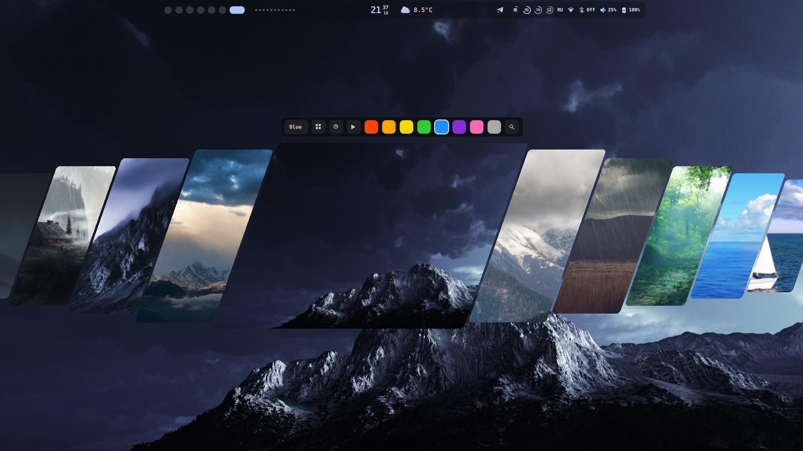
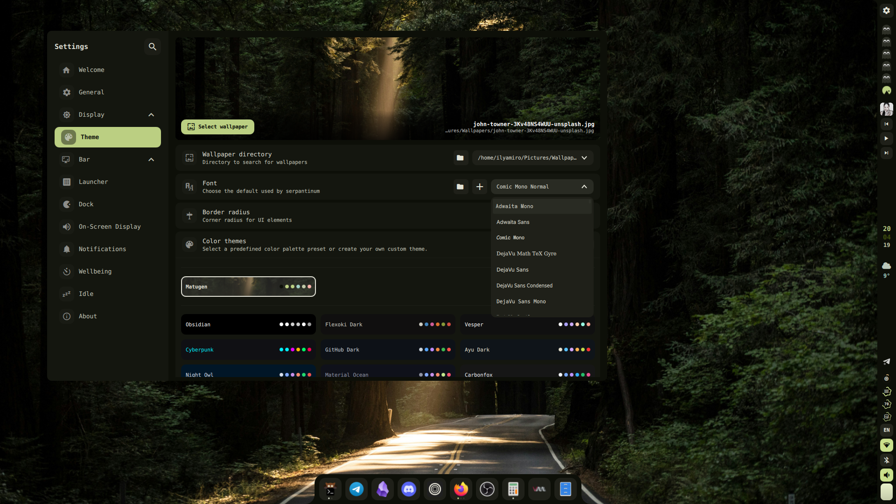
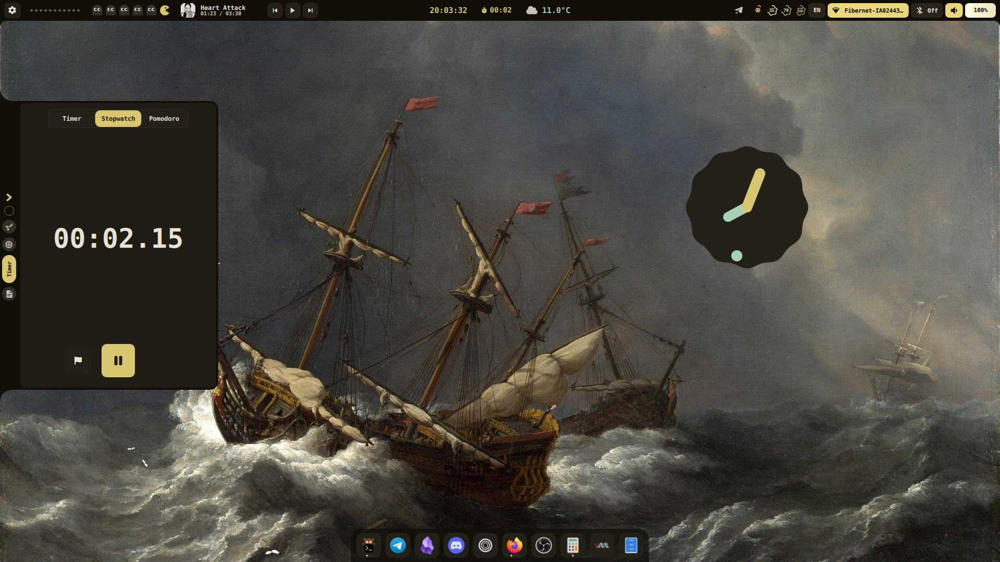

## Previews

| | |
|---|---|
|  |  |
|  |  |

## Installation

> [!TIP]
> Full installation and configuration instructions live at **[serpantinum.dev](https://serpantinum.dev)**.


Use this installer:

```bash
./serpantinum-install.sh
```


> [!NOTE]
> To update, when or if you recieve a notification about the new version being available, just run the script again and choose "update"

---

## Supported compositors

Hyprland, Niri, Sway and Mango. The installer detects the running compositor and deploys its configuration. On Fedora, Mango is installed from the Terra repository.

---

## Running

To run the shell, launch `serpantinumd start`

For configuration, see the [configuration guide](https://serpantinum.dev/configure).
