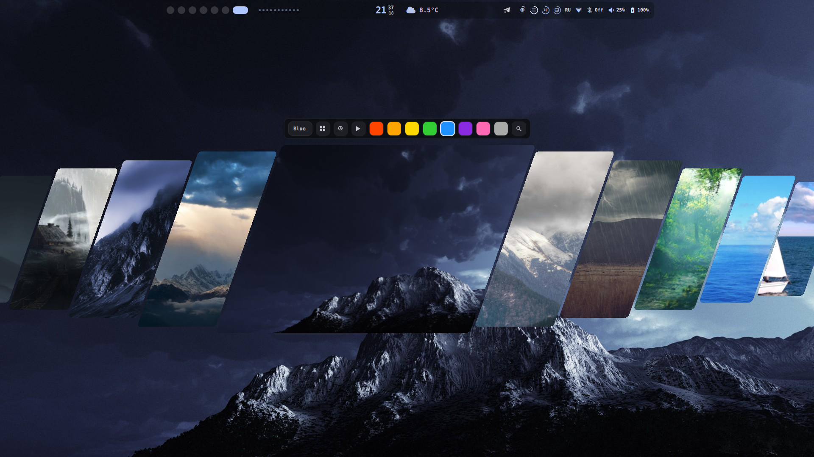
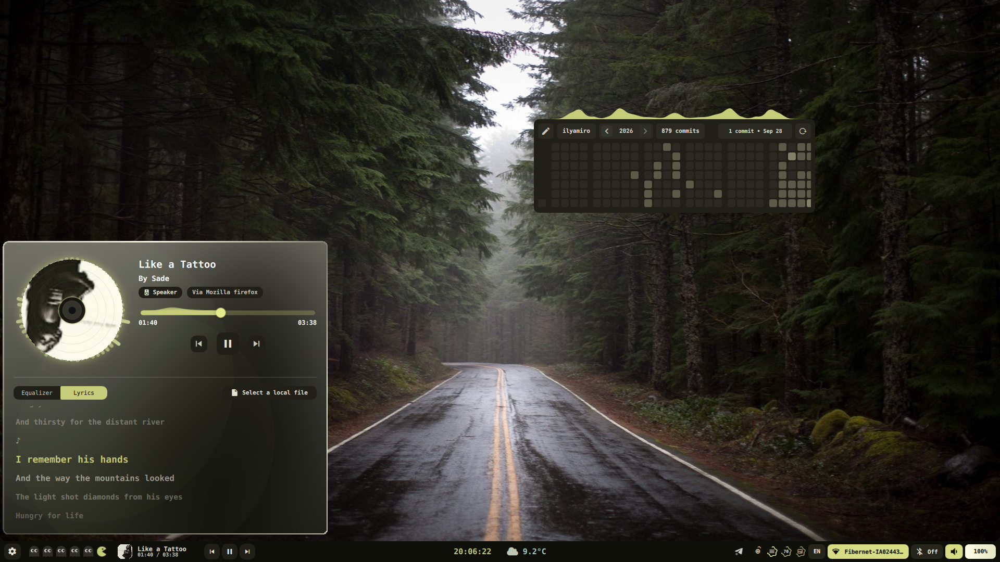
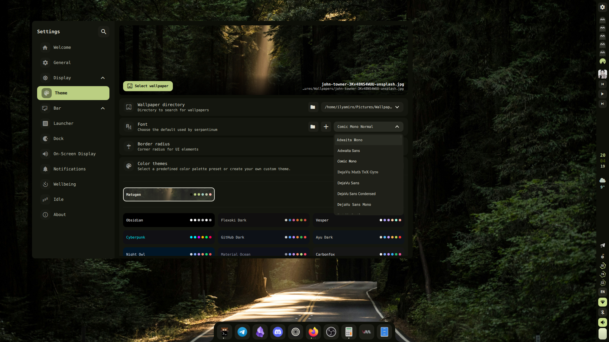
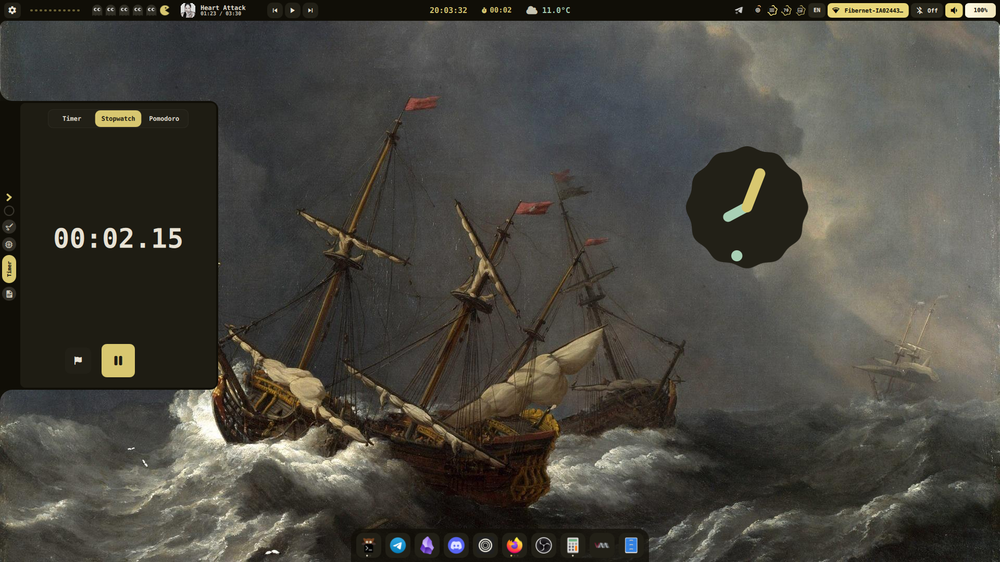

## Previews

| | |
|---|---|
|  |  |
|  |  |

## Installation

> [!TIP]
> Full installation and configuration instructions live at **[serpantinum.dev](https://serpantinum.dev)**.

<<<<<<< HEAD
> [!IMPORTANT]
> **Migrating from v1:** All previous configuration will be backed up and unused. Configuration of compositor settings such as monitors, keybinds, and autostart is now up to you, as the project migrated from being dotfiles to being a shell.

### Arch Linux, Fedora, Void Linux and their derivatives

For Arch-based distributions (including systemd, OpenRC, and other init systems), for Fedora-based distributions such as Nobara and Ultramarine, and for Void Linux (glibc and musl), run the automated installation script. It detects your distribution and uses `pacman`, `dnf` or `xbps`.
=======
>>>>>>> 63f7f14965fba45ed76c8a1b2724082a2ccd5ab4

Use this installer:

```bash
./serpantinum-install.sh
```


> [!NOTE]
> To update, when or if you recieve a notification about the new version being available, just run the script again and choose "update"

---

<<<<<<< HEAD
### NixOS

See the [NixOS installation guide](https://serpantinum.dev/installation/nixos) for flake setup, the NixOS and Home Manager modules, and updating.

---

## Audio engine

The equalizer, balance, mono, channel swap, dynamic range modes and the dynamic EQ run on [serpantinum-audio](https://github.com/ilyamiro/serpantinum-audio), a small PipeWire processor that replaces EasyEffects. The installer and the packages install it, and on the first start after updating, Serpantinum hands your audio over from EasyEffects. See the [audio engine guide](https://serpantinum.dev/audio).

---

=======
>>>>>>> 63f7f14965fba45ed76c8a1b2724082a2ccd5ab4
## Supported compositors

Hyprland, Niri, Sway and Mango. The installer detects the running compositor and deploys its configuration. On Fedora, Mango is installed from the Terra repository. On Void Linux, Hyprland is installed from the third-party black-hole.dev repository.

---

## Running

To run the shell, launch `serpantinumd start`

For configuration, see the [configuration guide](https://serpantinum.dev/configure).
